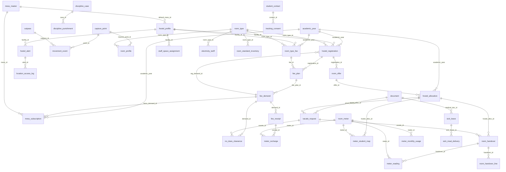

# Hostel module ER diagram (Workflows A–F, foreign keys inside the hostel and shared schemas)

Links to ref.student_master, ref.staff_master and infra.* are omitted for readability; see the data dictionary.

